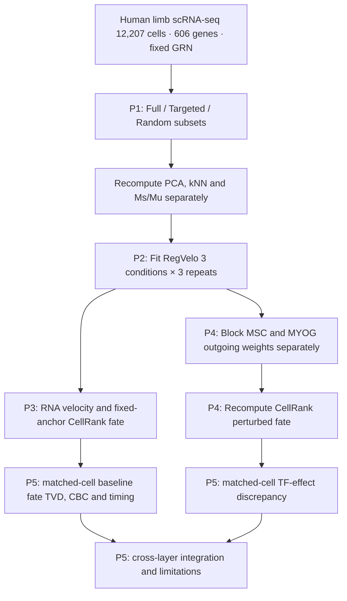

# Project final scientific guide | RegVelo under incomplete developmental sampling

> **FINAL / FROZEN for report and presentation — 2026-11-25**  
> CMU 02-512 / 02-712 · Fall 2026 · BioModelSimProject  
> **Primary purpose:** the team's single reference for scientific question, executed P1–P5 pipeline, verified quantitative findings, figures, file-level provenance, interpretation, and report/PPT preparation.  
> **Source of truth for P5 numerical results:** this package's `outputs/tables/` (generated by the user's completed local P5 run), not older draft summaries under `outputs/verified_from_github/`.

**How to use:** paths beginning with `../` are **relative to `P5_analysis/`** and refer to files at the team repository root; `outputs/...` refers to files inside this folder. `../results/p2/X/*/fitted.h5ad` and `model/model.pt` are **external release assets**, not stored in an ordinary Git clone. The guide references them without implying they are in this ZIP. Every substantive result below is linked to its source file; inspect the linked table before copying rounded values into the final report. No new model training is needed to present the completed study.

---

## 0. The story in 60 seconds / 最终故事

**Question.** With the gene panel and GRN prior held fixed, does selective loss of the intermediate **MyoB1** population change RegVelo's developmental and transcription-factor perturbation predictions more than removal of an equal number of randomly chosen **non-endpoint** cells?

**Design.** Use the 12,207-cell human embryonic limb myogenesis data; compare **Full** (12,207), **Targeted** (75% of 759 MyoB1 cells removed: 569 removed, 190 left; 11,638 total), and **Random** (569 non-endpoint cells removed; 11,638 total), across **three paired computational blocks** (9 RegVelo fits); apply **MSC** and **MYOG** weight-blockade separately to all nine fits (18 runs); evaluate latent time, boundary direction, baseline fate and perturbation-induced fate.

**What the evidence supports:**

1. **Targeted creates greater *mean unperturbed fate-distribution change* than Random** on exactly matched surviving nonterminal cells, in all 3 blocks: Targeted TVD **0.0600 / 0.0477 / 0.0290** vs Random **0.0422 / 0.0254 / 0.0214**. This persists when surviving MyoB1 source cells are excluded. See [baseline fate table](outputs/tables/baseline_fate_by_repeat.csv), [composition robustness](outputs/tables/fate_composition_robustness.csv), [figure](outputs/figures/fig_baseline_fate_tvd_by_repeat.png).
2. **MyoB1-associated local trajectory information changes more:** CBC-evaluable source cells for MyoB1→MyoC1 fall from **120** (Full) to **44 / 48 / 37** (Targeted), versus **117 / 115 / 109** (Random); on cells with a valid boundary in all conditions, Targeted has larger mean absolute CBC deviations in all blocks. However mean CBC among surviving evaluable cells remains similar, and **the *fraction* of remaining MyoB1 cells at a valid boundary increases**, so do not equate absolute loss of boundary evidence with falling boundary fraction. See [CBC coverage](outputs/tables/cbc_coverage_and_direction.csv), [matched CBC](outputs/tables/cbc_matched_boundary_cells.csv).
3. **TF perturbation predictions retain their main *average directions***: blocking MSC reduces modeled PAX7+MyoProg1 probability and blocking MYOG reduces modeled MYH3+MyoC probability, but **Targeted does *not* consistently exceed Random** in perturbation-effect discrepancy. For MSC→PAX7, Targeted−Random effect-error difference (percentage points) **−0.60 / +0.74 / +0.90**; for MYOG→MYH3 **−4.61 / +2.13 / −0.44**. See [P4 result note](../docs/p4_results.md), [P5 paired P4 summary](outputs/tables/perturbation_effects_existing_p4.csv).
4. **This is not an isolated MyoB1-specific biological effect:** the deleted Targeted cells disproportionately come from early developmental stages (**449 of 569** were PCW 5.4–6.1), the Random design is **not stage matched**, and different Full-data training seeds already produce appreciable fate divergence (**TVD 0.0187–0.0601** on the R0 common evaluation cohort). See [P1 sampling note](../docs/p1_data_notes.md), [P5 seed reference](outputs/tables/full_training_seed_variability.csv). The result is **pipeline sensitivity conditional on a fixed prior**, not a verified gene-regulatory causal effect.

**One-sentence conclusion:** *Structured loss of an intermediate myogenic population consistently alters RegVelo's unperturbed fate-probability predictions more than size-matched random non-endpoint loss, while perturbation-response stability and effect direction are more heterogeneous across computational repeats; these results are conditional on the selected data, prior, graph rebuilding and non-stage-matched sampling design.*

---

## 1. Scientific objective, comparison, and estimands

The **Full** fit is a reference for *prediction stability*, **not** biological ground truth. The intervention is removing cells *before preprocessing/model fitting*, rather than withholding labels and testing out-of-sample prediction. We ask whether an incompletely observed intermediate cell state changes the *fitted dynamical model and its downstream outputs*.

- **Primary structured-vs-random contrast:** for a scalar error measure `E`, `C_r = E(Targeted_r, Full_r) − E(Random_r, Full_r)` **within repeat r**, where all terms use the **same surviving evaluation cells**. `C_r > 0` means Targeted diverges more from Full *for that metric*; it does **not** imply a more biologically wrong answer.
- **Three computational blocks:** r0/r1/r2 use different sampling selections and training seeds, with the same training seed within each Full/Targeted/Random block. They are **not three donors, independent specimens, or biological replicates**. Sampling variation, optimization variation, and finite posterior decoding cannot be fully separated.
- **Common evaluation cohorts:** 11,104 / 11,105 / 11,113 total shared cells; exclude all three protected endpoint *cell types* (2,870 cells) for the primary P4/P5 analysis to obtain **8,234 / 8,235 / 8,243 nonterminal cells**. [P5 cohort counts](outputs/tables/comparison_cohorts.csv).
- **Predefined endpoints:** `PAX7+MyoProg1` (progenitor-like reservoir endpoint, **not** irreversibly mature), `MYH3+MyoC`, `MYL3+MyoC`. These are fixed algorithmic absorbing endpoints in CellRank, not actual lineage-tracing outcomes. [Fixed anchors](../results/p3/terminal_anchors/terminal_anchors.json).
- **Key boundary transitions:** `PAX3+MyoProg → MyoB1 → MyoC1` (targeted branch) and `PAX3+PAX7+MyoProg → MyoB2 → MyoC2` (comparison branch, **not** a guaranteed unaffected negative control). [Experiment config](../config/experiment.yaml).

### Experiment map

---

## 2. End-to-end methods, P1 → P5 (what was actually executed)

### P1 — Provenance, sampling, and fresh preprocessing

**Input and scope.** `rgv.datasets.human_limb()` / supplied preprocessed human limb data: **12,207 cells**, **606 genes**, **10 annotated cell types**, 10 PCW stages (5.1–9.3), 25 sample labels. The fixed binary skeleton is a **606×606 GRN prior**, with **77 annotated TFs**, **3,834 prior edges**, and rows **regulators** × columns **targets**. MSC has 283 and MYOG 297 *prior candidate targets*. These are *prior* counts, **not** the number of nonzero learned/ablated model weights. [P1 provenance/methods](../docs/p1_data_notes.md); [inspection code](../scripts/p1_01_inspect_inputs.py).

**Sampling rule and QC.** Targeted deletes 569 of 759 MyoB1; Random deletes exactly 569 cells from all eligible *non-endpoint* cells (Random may delete some MyoB1); **the three endpoint cell types are protected** in both schemes. Sampling seeds 1000–1002; training seeds 0–2. P1 records exact retained/removed IDs and validates all nine datasets for finite values, aligned genes/prior, nonconstant moments, connected graphs and intact endpoints. [Frozen plan](../config/experiment.yaml); [P1 manifest builder](../scripts/p1_02_make_manifests.py); [P1 QC](../results/p1/qc/qc_summary.csv).

**Clean rebuild matters:** The subset object does **not** reuse the original graph/moments. For each retained-cell set, recompute PCA (**50 components on `X`**), exact **30-neighbor / 30-PC** graph and neighborhood-smoothed `Ms`/`Mu`, then per-gene min–max scale. `spliced` and `unspliced` are previously per-cell normalized unsmoothed measurements, rather than raw counts simply inferred from the layer names. The supplied object's original graph is substantially different from a graph rebuilt on the fixed 606 genes, so **the rebuilt Full fit is not identical to the published tutorial input**. [P1 rebuild implementation](../src/p1_data/rebuild.py); [P1 methods](../docs/p1_data_notes.md); [P1 graph figure](../results/p1/figures/umap_removed_cells_r0.png).

**Information-loss check:** 449/569 Targeted deletions are PCW 5.4–6.1, while Random deletions are more distributed in later stages; the two schemes differ in developmental age composition as well as cell type. The original P1 *input graph* boundary support for MyoB1→MyoC1 falls from 163 to approximately 52–63 under Targeted; **do not confuse those P1 graph-support numbers with P3 CBC-evaluable counts (Full=120)**. [Deletion by stage](../results/p1/figures/removed_by_stage_r0.png); [P1 boundary support](../results/p1/figures/boundary_support_by_condition.png); [P1 Ms shift](../results/p1/figures/delta_Ms_vs_full_by_celltype.png).

**Reproduce/locate:** `scripts/p1_01_inspect_inputs.py` through `scripts/p1_04_compare_conditions.py`; primary text [docs/p1_data_notes.md](../docs/p1_data_notes.md); exact input location per selected P2 run is `../data/prepared_p2/{condition}_r{repeat}.h5ad` **when the external inputs release has been extracted**. Note that the earlier P1 notes mention `data/prepared`, whereas the **executed P2 X configuration** specifies `data/prepared_p2`; use [config/p2_x.yaml](../config/p2_x.yaml) for executed fit identities.

### P2 — Nine RegVelo fits and tutorial baseline

**Executed model:** RegVelo 1.0.0 / `REGVELOVI`, regularized using the fixed prior with `soft_constraint=True`, `lam2=1.0`, AdamW optimization and early stopping (max 1,500 epochs), **30 posterior samples**, full-batch objective with memory-optimized ODE chunking. Each condition is independently refit after rebuilding its own PCA/neighbors/moments. [Executed settings](../config/p2_x.yaml); [fitting code](../scripts/p2_fit.py); [fitting handoff](../docs/p2_model_fitting.md).

**What is modeled:** the RegVelo dynamical decoder links gene regulation of transcription to RNA splicing:

\[
\frac{du_g}{dt}=\alpha_g(s;W)-\beta_g u_g,\qquad
\frac{ds_g}{dt}=\beta_g u_g-\gamma_gs_g.
\]

`W` is the **learned** regulatory interaction matrix constrained by a **fixed prior**; output `velocity` and inferred latent time are properties of this fitted model, not measured physical time or an experimentally validated GRN. [Fitting code](../scripts/p2_fit.py); [model notes](../docs/p2_model_fitting.md).

**Status:** all **nine X experimental fits plus one separate tutorial baseline** completed; tutorial uses shipped data/moments, so **do not mix tutorial with the nine-run design**. Recorded correlations between fitted latent time and actual PCW stage are:

| Repeat | Full | Targeted | Random |
|---|---:|---:|---:|
| R0 | 0.5373 | 0.5148 | 0.4171 |
| R1 | 0.5449 | 0.5099 | 0.5830 |
| R2 | 0.4780 | 0.5684 | 0.5336 |

No consistent degradation under Targeted relative to Random. The *common-cell* latent-time Spearman agreement between Full and Targeted is **0.9742 / 0.9724 / 0.9450** across blocks, high but not a validation of the true differentiation trajectory. [P2 run summary](../results/p2/comparison/run_summary.csv); [P2 matched timing](../results/p2/comparison/paired_latent_time.csv); [P5 copied timing](outputs/tables/latent_time_pairwise_existing.csv); [P2 stage figure](../results/p2/comparison/shared_cell_stage_correlation.png).

**Where outputs live:** `../results/p2/X/{condition}_r{repeat}/fitted.h5ad`, `model/model.pt`, `training.csv`, `run.json`. Large `.h5ad` and `.pt` files are downloadable from the [P2 completed fitting release](https://github.com/ashwathr1008/BioModelSimProject/releases/tag/p2-x-completed-2026-11-22) and may **not be present in Git**. The repo does contain [summary tables](../results/p2/comparison/run_summary.csv).

### P3 — Fixed endpoints, fate probabilities, and local trajectory evaluation

**Terminal anchors:** derive selected terminal macrostates from the rebuilt Full r0 reference, intersect with biological cell type labels, save **106 fixed anchor cell IDs**: **53 PAX7+MyoProg1, 23 MYH3+MyoC, 30 MYL3+MyoC**. Reuse the *same* anchor IDs across all conditions/repeats and downstream perturbations; this standardizes endpoint definition but **does not constitute independent endpoint recovery** in each fit. [Selection script](../scripts/p3_02_terminal_anchors.py); [anchor IDs](../results/p3/terminal_anchors/terminal_anchors.json).

**Fate inference:** construct `K = 0.8 × VelocityKernel + 0.2 × ConnectivityKernel` using fitted `velocity`, smoothed `Ms`, and condition-specific connectivity; run CellRank GPCCA with the fixed absorbing-state anchor dictionary and solve for the three absorption probabilities per cell. [Exact inference function](../src/p3_analysis/fate_inference.py); [nine fate CSVs](../results/p3/fate/); [r0 fate visualization](../results/p3/figures/fate_comparison_r0.png). These are **model-predicted fate probabilities**, not observed end states.

**CBC / local trajectory:** score four prespecified source→target boundaries using CellRank's CBC function, condition's kernel, and run-specific PCA/neighbor graph. Save mean scores *and* eligible boundary counts, plus per-cell scores for a matched comparison. [CBC implementation](../src/p3_analysis/trajectory.py); [all CBC](../results/p3/summary/all_cbc.csv); [cell-level CBC](../results/p3/cell_level_cbc/all_cell_cbc.csv); [timing](../results/p3/summary/all_timing.csv).

**Core observation:** mean MyoB1→MyoC1 CBC is similar in Full and Targeted, **but support collapses in absolute cell count** (details §3.2). A larger share of the *remaining* MyoB1 population may still have valid CBC. No universal claim of increased/decreased biological direction correctness follows. CBC is a pipeline-dependent local diagnostic, not ground truth.

### P4 — TF regulatory blockade, not an experimental knockout

**Executed 18 main interventions:** for each of nine fitted models, reload the matching checkpoint and independently set nonzero outgoing learned regulatory weights for **MSC** or **MYOG** to 0 (`effects=0`, `cutoff=0`), then recompute model velocity and CellRank fate with the same anchor set and 0.8/0.2 kernel blend. **Do not** describe this as removing the MSC/MYOG RNA expression, editing the cells, or a wet-lab knockout; the model is **not retrained** for the counterfactual. [P4 methods](../docs/p4_perturbations.md); [P4 implementation](../scripts/p4_perturb.py); [P4 summary](../docs/p4_results.md).

**Statistical effect per cell and endpoint:** `delta_p = p_perturbed − p_unperturbed` **inside the same condition/model**, then compare the *delta_p* across sampling conditions on identical shared cells. In total P4 reports **18 intervention analyses**, **638,694 cell × regulator × endpoint rows** (not 638,694 unique cells). [P4 QC](../results/p4/qc/main_outputs.json); [P4 manifest](../results/p4/run_manifest.csv).

**Observed effect direction:** across all nine fits, blocking MSC lowered the *mean* PAX7+MyoProg1 fate probability by **2.67–6.44 percentage points**, while blocking MYOG lowered the *mean* MYH3+MyoC fate probability by **3.00–12.95 pp** on matched nonterminal cells. MYL3+MyoC signed means were near zero in main fits, but individual cell changes may cancel. The P4 result is a **model perturbation prediction**, not confirmation that MSC/MYOG are the causal regulators in vitro. [P4 result figure](../results/p4/signed_fate_changes.png); [P4 source summary](../results/p4/shared_cell_effects_by_repeat.csv).

**Reproduction/tutorial qualification:** tutorial depletion AUC under the project pipeline differs from the paper, most notably MYOG→MYL3 (here **0.525** vs published **0.747**); the checkpoint, anchors and kernel differ. Do not use a published tutorial AUC as if it were reproduced or interpret depletion AUC as percent lineage loss. [Tutorial AUC table](../results/p4/tutorial/depletion_check.csv).

### P5 — Statistical integration on the same cells

**Execution:** `python3 P5_analysis/run_analysis.py` generated the present `outputs/tables/` and `outputs/figures/` on the uploaded local project. P5 validates paired cell IDs, sums the three fate probabilities, compares CBC on shared eligible boundary cells, imports P4 `delta_p` (from original 18 gzipped files), calculates cell-type/stage summaries, and tests cross-layer error association. [P5 script](run_analysis.py); [completed local report](outputs/reports/findings.md); [per-cell association](outputs/tables/cross_layer_per_cell_association.csv).

The following sections list **final primary results**. Legacy `outputs/verified_from_github/` contains earlier independent audit/supplemental figures and summary reproductions, but **do not use legacy status text to override the completed local run**.

---

## 3. Results: all key quantitative evidence and interpretation

### 3.1 Baseline/unperturbed fate stability — primary P5 result

For each shared nonterminal cell `i`, let `p_i^F`, `p_i^T`, `p_i^R` be three-element probability vectors for the predefined endpoints. Define

\[
\operatorname{TVD}(P,Q)=\tfrac12\sum_{k=1}^{3}|P_k-Q_k|,\qquad
D_T^{(r)}=\frac1{n_r}\sum_i\operatorname{TVD}(p_i^T,p_i^F),\quad
D_R^{(r)}=\frac1{n_r}\sum_i\operatorname{TVD}(p_i^R,p_i^F).
\]

**TVD is symmetric total-variation distance, *not* symmetric KL**. It ranges from 0 to 1; a TVD of 0.06 means on average 6 percentage points of the predicted **probability mass** must be reassigned to match the reference, **not** that 6% of cells change fate.

| Repeat | n matched nonterminal | Targeted mean TVD | Random mean TVD | T−R |
|---|---:|---:|---:|---:|
| R0 | 8,234 | **0.06001** | 0.04217 | **+0.01785** |
| R1 | 8,235 | **0.04774** | 0.02537 | **+0.02237** |
| R2 | 8,243 | **0.02899** | 0.02140 | **+0.00758** |

**Support:** all 3 block-level *mean* contrasts positive. The paired *median cell-level* contrast need **not** share the same sign (R0 median T−R is slightly negative), so the statement is **mean-level**, not "every cell is more affected". [TVD by repeat](outputs/tables/baseline_fate_by_repeat.csv); [paired contrast](outputs/tables/baseline_fate_contrast_by_repeat.csv); [full per-cell TVDs](outputs/tables/baseline_fate_per_cell.csv.gz); [main figure](outputs/figures/fig_baseline_fate_tvd_by_repeat.png).

**Most likely fate classification changes much less:** Targeted fate flip rates **3.49% / 2.89% / 1.84%**, Random **3.17% / 2.70% / 0.90%**. A model can shift probabilities without changing the argmax fate label. [Same baseline table](outputs/tables/baseline_fate_by_repeat.csv).

**Direction is not consistent:** Targeted mean `ΔPAX7` is **+0.0561 / +0.0450 / −0.0257**, and mean `ΔMYH3` is **−0.0593 / −0.0454 / +0.0258**. R2 reverses the main signed redistribution of R0/R1. **Do not claim** MyoB1 removal consistently sends cells *toward* PAX7 or *away from* MYH3. [Signed endpoint changes by repeat](outputs/tables/baseline_fate_by_repeat.csv).

### 3.2 Local transition boundary: fewer evaluable cells, larger matched-cell CBC deviations

**Boundary `MyoB1 → MyoC1`:**

| Repeat | Full valid / total source | Targeted valid / source | Random valid / source | Matched cells in all three | Targeted matched mean | Random matched mean |
|---|---|---|---|---:|---:|---:|
| R0 | 120 / 759 | 44 / 190 | 117 / 713 | 31 | **0.09938** | 0.04490 |
| R1 | 120 / 759 | 48 / 190 | 115 / 712 | 30 | **0.08356** | 0.03321 |
| R2 | 120 / 759 | 37 / 190 | 109 / 702 | 22 | **0.09433** | 0.03465 |

Matched columns are **mean absolute differences of individual CBC scores from Full**, not CBC means. The Full **mean CBC** remains ~0.808–0.827, Targeted ~0.802–0.814; this is not a loss of all directional information. The **valid-boundary fraction** of surviving MyoB1 actually changes from Full **120/759 = 15.8%** to Targeted **44/190 = 23.2%**, **48/190 = 25.3%**, **37/190 = 19.5%**. The strongest and safe conclusion is **loss of absolute boundary evidence** plus **larger matched-cell directional diagnostic shifts**, not "lower boundary fraction". [Coverage and CBC means](outputs/tables/cbc_coverage_and_direction.csv); [paired CBC](outputs/tables/cbc_matched_boundary_cells.csv); [full branch contrasts](outputs/tables/cbc_summary_contrasts.csv); [source cell scores](../results/p3/cell_level_cbc/all_cell_cbc.csv).

**Upstream `PAX3+MyoProg → MyoB1`:** on matched evaluable cells, Targeted mean absolute CBC change **0.1412 / 0.1085 / 0.0958** vs Random **0.0597 / 0.0339 / 0.0412**, consistently larger. The MyoB2 comparison route has mixed smaller differences and is not a biologically isolated control. [Matched CBC](outputs/tables/cbc_matched_boundary_cells.csv).

**Measurement caveat:** CBC depends on the condition-specific graph, PCA and boundary eligibility; these are *not* matched across all possible original cells. Reports must give `n_paired_boundary_cells` and coverage counts rather than just plotting means.

### 3.3 Cell-type composition and developmental-stage sensitivity

**MyoB1 source cells that survive all conditions** have larger Targeted mean fate TVD than Random in all repeats:

| Repeat | n common MyoB1 | Targeted TVD | Random TVD |
|---|---:|---:|---:|
| R0 | 179 | **0.2063** | 0.1196 |
| R1 | 179 | **0.0972** | 0.0513 |
| R2 | 177 | **0.0776** | 0.0641 |

For most other cell types the Targeted-versus-Random contrast is heterogeneous across repeats; the global mean trend is **not** proof that all seven source types are consistently more affected. [Cell-type table](outputs/tables/baseline_fate_by_cell_type.csv); [cell-type contrast plot](outputs/figures/fig_fate_tvd_celltype_contrasts.png).

**Remove MyoB1 from the evaluation cohort** (not from the training design):

| Repeat | n shared non-MyoB1 | Targeted TVD | Random TVD |
|---|---:|---:|---:|
| R0 | 8,055 | **0.05676** | 0.04045 |
| R1 | 8,056 | **0.04664** | 0.02479 |
| R2 | 8,066 | **0.02792** | 0.02047 |

Thus the effect extends beyond the **remaining** MyoB1 source cells; this does **not** establish an intercellular causal influence, because preprocessing/moments, training and cell-stage composition also changed. [Composition robustness](outputs/tables/fate_composition_robustness.csv); [supplemental figure](outputs/verified_from_github/figures/verified_excluding_myoB1.png).

**Stage stratification:** early cells often show larger fate TVD; the deleted Targeted cohort contains many early PCW observations. Stage-stratified results are **descriptive**, not a stage-matched control. [Stage-stratified table](outputs/tables/baseline_fate_by_stage.csv); [stage figure](outputs/verified_from_github/figures/verified_stage_stratified_baseline.png); [sampling-stage imbalance figure](../results/p1/figures/removed_by_stage_r0.png).

### 3.4 Baseline dynamics and fitted model variation

The nine stage correlations in §2/P2 have no repeat-consistent Targeted disadvantage, and pairwise *Full-vs-Targeted* latent-time rank agreement remains high. High global correlation does not exclude changes in local velocity, boundary membership, or fate probabilities. [Stage analysis](../results/p2/comparison/shared_cell_stage.csv); [paired latent time](outputs/tables/latent_time_pairwise_existing.csv).

**Important reference: Full-vs-Full (no cell deletions).** Compare Full r0/r1/r2 on the **same R0 common nonterminal evaluation cohort**:

| Reference comparison | Mean TVD |
|---|---:|
| Full r0 vs Full r1 | 0.01871 |
| Full r0 vs Full r2 | 0.04628 |
| Full r1 vs Full r2 | 0.06012 |

This overlaps the magnitude of some deletion-induced TVDs, so *training seed / posterior inference variation* may be substantial. But this is **not** a statistical null distribution to subtract from the Targeted−Random contrast; there are only three Full fits. [Full-seed variability table](outputs/tables/full_training_seed_variability.csv); [seed reference plot](outputs/verified_from_github/figures/verified_full_seed_variability.png).

### 3.5 MSC/MYOG intervention predictions — main mechanistic *model* readout

For the same shared nonterminal cells, the P4 estimand is

\[
\Delta p_{i,k}^{c,TF}=p_{i,k}^{c,TF\text{-blocked}}-p_{i,k}^{c,baseline},\qquad
E_c^{TF,k}=\operatorname{mean}_i\left|\Delta p_{i,k}^{c,TF}-\Delta p_{i,k}^{F,TF}\right|,\quad c\in\{T,R\}.
\]

The main **Targeted−Random discrepancy** `E_T−E_R` (here **percentage points**) is:

| TF → endpoint | R0 | R1 | R2 | Pattern |
|---|---:|---:|---:|---|
| **MSC → PAX7+MyoProg1** | **−0.60** | **+0.74** | **+0.90** | Targeted larger 2/3 |
| **MYOG → MYH3+MyoC** | **−4.61** | **+2.13** | **−0.44** | Targeted larger 1/3 |

Positive = Targeted changes the predicted TF effect more than Random; negative = Random changes it more. All three endpoints for both TFs are evaluated; do not select only favorable entries post hoc. **The direction of the average main TF effect remains consistent**, but the **relative discrepancy magnitude** between sampling conditions is inconsistent. [All P4 endpoint contrasts](outputs/tables/perturbation_effects_existing_p4.csv); [per-source P4 contrasts](outputs/tables/perturbation_by_source_celltype_existing_p4.csv); [P4 repeat plot](../results/p4/perturbation_stability.png); [P4 narrative](../docs/p4_results.md).

### 3.6 Cross-layer: baseline fate change vs perturbation-effect change

P5 computed, for the same cell `i` and endpoint `k`, two *nonnegative* error variables:

\[
e_{i,k}^{B,c}=|p_{i,k}^{c,baseline}-p_{i,k}^{F,baseline}|,\qquad
e_{i,k}^{P,c,TF}=|\Delta p_{i,k}^{c,TF}-\Delta p_{i,k}^{F,TF}|.
\]

**These must not be confused with `delta_p` itself.** The local run calculated per-cell Spearman correlation of the two error variables, plus top-decile overlap (fraction of one top-10% set also in the other). Example **MYOG → MYH3+MyoC**:

| Repeat | Targeted Spearman ρ | Random Spearman ρ | Targeted top-decile overlap |
|---|---:|---:|---:|
| R0 | 0.947 | 0.787 | 79.2% |
| R1 | 0.640 | 0.845 | 1.6% |
| R2 | 0.839 | 0.783 | 33.0% |

Baseline and TF-effect errors are positively correlated at cell level, but the *most affected* cells vary widely by repeat and condition. The two error variables **share baseline prediction terms by construction**, so correlation alone is **not evidence of shared biological mechanism** or independent predictive instability. [Per-cell association](outputs/tables/cross_layer_per_cell_association.csv); [by-cell-type errors](outputs/tables/cross_layer_by_celltype.csv).

**Different marginal sensitivity patterns:** for MYOG→MYH3 R0, Targeted mean baseline error ≈ **0.05997** vs Random **0.04160**, while Targeted mean TF-effect error ≈ **0.03633** vs Random **0.08241**; the *ordering reverses*. This does not mean the two are independent—**magnitude, rank association, and endpoint-specific counterfactual response are different concepts**. [Mean-error comparison](outputs/tables/cross_layer_baseline_vs_perturbation.csv); [cross-layer plot](outputs/figures/fig_cross_layer_error.png).

---

## 4. Evidence registry: exact paths, how to cite, and whether available in Git

| Evidence / use | Canonical source path (relative to `P5_analysis/`) | Status / note |
|---|---|---|
| Scientific design / cells / cohorts | [`../config/experiment.yaml`](../config/experiment.yaml), [`../config/p2_x.yaml`](../config/p2_x.yaml) | Source in repository; P2 config is the **executed** fit plan |
| P1 normalization, graphs, sampling details | [`../docs/p1_data_notes.md`](../docs/p1_data_notes.md), [`../src/p1_data/rebuild.py`](../src/p1_data/rebuild.py) | Source in repository |
| Sampling visuals | [`../results/p1/figures/removed_by_stage_r0.png`](../results/p1/figures/removed_by_stage_r0.png), [`../results/p1/figures/umap_removed_cells_r0.png`](../results/p1/figures/umap_removed_cells_r0.png), [`../results/p1/figures/boundary_support_by_condition.png`](../results/p1/figures/boundary_support_by_condition.png) | Source in repository |
| P2 fitting and latent time | [`../docs/p2_model_fitting.md`](../docs/p2_model_fitting.md), [`../scripts/p2_fit.py`](../scripts/p2_fit.py), [`../results/p2/comparison/run_summary.csv`](../results/p2/comparison/run_summary.csv), [`../results/p2/comparison/paired_latent_time.csv`](../results/p2/comparison/paired_latent_time.csv) | Source in repository |
| P2 fitted model + AnnData | `../results/p2/X/{condition}_r{repeat}/model/model.pt` and `fitted.h5ad` | **External release; not bundled/usually gitignored** |
| P3 terminal anchor identities | [`../results/p3/terminal_anchors/terminal_anchors.json`](../results/p3/terminal_anchors/terminal_anchors.json) | Source in repository |
| P3 fate probabilities (9 files) | `../results/p3/fate/{condition}_r{repeat}_fate.csv` | Source in repository |
| P3 directional scores / CBC cells | [`../results/p3/summary/all_cbc.csv`](../results/p3/summary/all_cbc.csv), [`../results/p3/cell_level_cbc/all_cell_cbc.csv`](../results/p3/cell_level_cbc/all_cell_cbc.csv) | Source in repository |
| P3 fate figure | [`../results/p3/figures/fate_comparison_r0.png`](../results/p3/figures/fate_comparison_r0.png) | Source in repository |
| P4 independent regulator blockades | [`../docs/p4_perturbations.md`](../docs/p4_perturbations.md), [`../scripts/p4_perturb.py`](../scripts/p4_perturb.py), [`../results/p4/run_manifest.csv`](../results/p4/run_manifest.csv) | Source in repository |
| P4 original per-cell effects (18 tables) | `../results/p4/{condition}_r{repeat}/{MSC,MYOG}.csv.gz` | Source in repository; **not included in this P5 ZIP** |
| P4 reported findings and validation | [`../docs/p4_results.md`](../docs/p4_results.md), [`../results/p4/qc/main_outputs.json`](../results/p4/qc/main_outputs.json) | Source in repository |
| **P5: cohort count (3 rows)** | [`outputs/tables/comparison_cohorts.csv`](outputs/tables/comparison_cohorts.csv) | **Bundled, local run complete** |
| **P5: primary baseline fate result** | [`outputs/tables/baseline_fate_by_repeat.csv`](outputs/tables/baseline_fate_by_repeat.csv), [`outputs/tables/baseline_fate_contrast_by_repeat.csv`](outputs/tables/baseline_fate_contrast_by_repeat.csv) | **Bundled, local run complete** |
| P5: all 49,424 cell × condition fate comparisons | [`outputs/tables/baseline_fate_per_cell.csv.gz`](outputs/tables/baseline_fate_per_cell.csv.gz) | **Bundled, local run complete** |
| P5: cell-type, stage, and non-MyoB1 robustness | [`outputs/tables/baseline_fate_by_cell_type.csv`](outputs/tables/baseline_fate_by_cell_type.csv), [`outputs/tables/baseline_fate_by_stage.csv`](outputs/tables/baseline_fate_by_stage.csv), [`outputs/tables/fate_composition_robustness.csv`](outputs/tables/fate_composition_robustness.csv) | **Bundled, local run complete** |
| P5: matched boundary CBC and coverage | [`outputs/tables/cbc_matched_boundary_cells.csv`](outputs/tables/cbc_matched_boundary_cells.csv), [`outputs/tables/cbc_coverage_and_direction.csv`](outputs/tables/cbc_coverage_and_direction.csv) | **Bundled, local run complete** |
| P5: P4 pooled/stratified contrasts | [`outputs/tables/perturbation_effects_existing_p4.csv`](outputs/tables/perturbation_effects_existing_p4.csv), [`outputs/tables/perturbation_by_source_celltype_existing_p4.csv`](outputs/tables/perturbation_by_source_celltype_existing_p4.csv) | **Bundled, local run complete** |
| **P5: actual cell-level cross-layer association** | [`outputs/tables/cross_layer_per_cell_association.csv`](outputs/tables/cross_layer_per_cell_association.csv), [`outputs/tables/cross_layer_by_celltype.csv`](outputs/tables/cross_layer_by_celltype.csv) | **Bundled, local run complete** |
| P5: Full training seed sensitivity | [`outputs/tables/full_training_seed_variability.csv`](outputs/tables/full_training_seed_variability.csv) | **Bundled, local run complete** |
| P5 finished programmatic report | [`outputs/reports/findings.md`](outputs/reports/findings.md) | **Bundled, local run complete** |
| P5 all primary graphs | [`outputs/figures/`](outputs/figures/) | **Bundled, 3 main PNGs** |
| Exact frozen artifact checksums | [`FINAL_FREEZE_MANIFEST.json`](FINAL_FREEZE_MANIFEST.json) | **Bundled, generated with this guide** |

For a manuscript/table citation use the **specific CSV table**, not only the figure. For reproducibility cite the relevant code **and** configuration. Each figure can be re-generated from the associated data using [`run_analysis.py`](run_analysis.py), provided the original P3/P4 data are present in the repository.

---

## 5. PPT storyboard (10 slides, ready to assign)

| Slide | Take-home sentence / suggested title | Evidence or image to insert | Speaker emphasis |
|---|---|---|---|
| 1 | **Does incomplete developmental sampling destabilize inferred cell dynamics?** | Optional P1 UMAP: [`../results/p1/figures/umap_removed_cells_r0.png`](../results/p1/figures/umap_removed_cells_r0.png) | Why data coverage is a scientific and modeling concern |
| 2 | **Fixed network prior, three sampling conditions, nine fits** | [`../results/p1/figures/removed_by_celltype_r0.png`](../results/p1/figures/removed_by_celltype_r0.png); design diagram in §1 | 569 removed; endpoint protected; 3 paired computational blocks |
| 3 | **Deleting cells changes the graph and its RNA moments** | [`../results/p1/figures/delta_Ms_vs_full_by_celltype.png`](../results/p1/figures/delta_Ms_vs_full_by_celltype.png), [`../results/p1/figures/removed_by_stage_r0.png`](../results/p1/figures/removed_by_stage_r0.png) | Show the preprocessing path and stage confounding |
| 4 | **RegVelo + CellRank: from dynamics to three fate probabilities** | Flow from §§2/P2–P3; [`../results/p3/figures/full_r0_fate_umap.png`](../results/p3/figures/full_r0_fate_umap.png) | 606 genes, fixed GRN, ODEs, fixed 106 anchors; illustrative not biological truth |
| 5 | **Local trajectory support is lost even when mean CBC persists** | [`outputs/tables/cbc_coverage_and_direction.csv`](outputs/tables/cbc_coverage_and_direction.csv), [`outputs/tables/cbc_matched_boundary_cells.csv`](outputs/tables/cbc_matched_boundary_cells.csv); optionally create a two-panel plot | Valid counts 120→37–48, matched shifts vs Random; denominator caveat |
| 6 | **Targeted increases mean baseline fate TVD in all three blocks** | [`outputs/figures/fig_baseline_fate_tvd_by_repeat.png`](outputs/figures/fig_baseline_fate_tvd_by_repeat.png) | Define TVD; 0.060/0.048/0.029 vs controls; only 1.8–3.5% argmax flips |
| 7 | **Effects extend beyond MyoB1, with heterogeneous direction** | [`outputs/figures/fig_fate_tvd_celltype_contrasts.png`](outputs/figures/fig_fate_tvd_celltype_contrasts.png), [`outputs/tables/fate_composition_robustness.csv`](outputs/tables/fate_composition_robustness.csv) | Excluding MyoB1 still positive; R2 direction reverses |
| 8 | **MSC/MYOG mean blockade effects persist, but magnitude is inconsistent** | [`../results/p4/signed_fate_changes.png`](../results/p4/signed_fate_changes.png), [`../results/p4/perturbation_stability.png`](../results/p4/perturbation_stability.png) | Model weight ablation, not wet-lab KO; MSC 2/3 vs MYOG 1/3 |
| 9 | **Baseline and perturbation sensitivity do not have identical patterns** | [`outputs/figures/fig_cross_layer_error.png`](outputs/figures/fig_cross_layer_error.png), [`outputs/tables/cross_layer_per_cell_association.csv`](outputs/tables/cross_layer_per_cell_association.csv) | R0 MYOG contrast reversal; per-cell association ≠ biological coupling |
| 10 | **What can we conclude—and what remains unidentifiable?** | Summary in §0 + constraints in §7; optional [`outputs/verified_from_github/figures/verified_full_seed_variability.png`](outputs/verified_from_github/figures/verified_full_seed_variability.png) | Stage confound, seed variation, fixed-prior and no ground truth |

**Presentation priorities if time is short (6–7 slides):** combine 2+3, 4+5, and 7+9. Spend most time on slides 5, 6, 8, 9; these contain the actual scientific contrast. **Do not build a slide about a 10×10 transition matrix as though it was calculated.**

---

## 6. Report writing plan and ready-to-adapt English passages

### Recommended report structure

1. **Introduction / Motivation:** sampled trajectories may miss transient intermediates; GRN-informed inference might be sensitive to missing observations. Define a *sensitivity* question, not an accuracy/validation or causal discovery claim. Cite RegVelo paper and its human-limb tutorial in the final bibliography.
2. **Data and experimental design:** P1 data provenance, fixed 606-gene panel/GRN, nine fit grid, 569 removed, protected endpoints, three computational blocks, stage-confound upfront. Sources: [P1 notes](../docs/p1_data_notes.md), [configs](../config/experiment.yaml).
3. **Methods:** P1 graph/moments reconstruction; P2 regularized RegVelo fit and latent-time score; P3 0.8/0.2 kernel, fixed 106 anchors, CBC; P4 weight blockade; P5 paired estimands/TVD, mean absolute CBC/error, cross-layer Spearman. Sources: [P2 fit code](../scripts/p2_fit.py), [P3 fate code](../src/p3_analysis/fate_inference.py), [P4 methods](../docs/p4_perturbations.md), [P5 code](run_analysis.py).
4. **Results 1 — information loss and trajectories:** P1 removed-by-stage/graph, P2 latent-time, P3 CBC coverage and matched CBC (do **not** equate valid counts with CBC mean). Sources: §3.2, §3.4.
5. **Results 2 — unperturbed fate stability:** P5 TVD, argmax flip, stage/cell-type subsets, R2 reversal. Sources: §3.1, §3.3.
6. **Results 3 — counterfactual TF response:** main signed effects, paired targeted-vs-random effects, tutorial mismatch; optional cross-layer figure/correlation. Sources: §3.5, §3.6.
7. **Discussion / limitations / conclusion:** distinct sensitivity patterns, original Full-vs-Full variability, stage confounding, no stage-matched control, fixed prior and pretrained gene selection, selected TFs, model-derived endpoints, no experimental perturbation. Sources: §7.

### Suggested English Results text (adapt figure numbering to actual report)

> **Sampling-dependent changes in unperturbed fate predictions.** We compared RegVelo–CellRank fate probabilities for the same surviving nonterminal cells within three computational blocks. Selective depletion of MyoB1 produced a greater mean total-variation distance (TVD) from the full-data reference than equal-sized random non-endpoint depletion in all blocks (targeted: 0.0600, 0.0477, 0.0290; random: 0.0422, 0.0254, 0.0214). The contrast persisted when surviving MyoB1 source cells were excluded. However, most cells retained their highest-probability fate class, and the direction of the mean PAX7/MYH3 probability redistribution reversed in the third block. Thus, targeted depletion more consistently altered the **magnitude** than the **direction** of modeled fate predictions.

> **Local transition evidence and perturbation responses.** Along the MyoB1→MyoC1 boundary, the number of CBC-evaluable source cells decreased from 120 in the full fit to 37–48 under targeted depletion, compared with 109–117 under random depletion. On the 22–31 boundary cells evaluable in all conditions per block, targeted depletion also produced larger absolute changes in CBC scores. Despite these shifts, the average modeled effects of blocking MSC on PAX7+MyoProg1 fate and MYOG on MYH3+MyoC fate retained their expected signs across nine fits. The **relative** magnitude of targeted-versus-random perturbation-effect discrepancies was inconsistent across blocks, indicating that stronger changes in baseline fate probabilities did not imply a uniformly stronger change in predicted TF-response effects.

### Suggested English Discussion text

> The findings characterize **within-dataset sensitivity** of a GRN-informed dynamical inference pipeline rather than the biological correctness of individual fate or TF-intervention predictions. The three computational blocks are not independent biological replicates; full-data fits with identical cells but different seeds showed appreciable prediction variability. Moreover, MyoB1 depletion disproportionately removed early developmental-stage observations, whereas the random control did not match stage, preventing isolation of cell-state identity from developmental-stage coverage. The gene panel and GRN prior were fixed from the supplied study, and the simulated TF blockades modified learned regulatory weights rather than recreating cellular gene knockouts. Consequently, the results support readout-specific sensitivity under this defined sampling design, not a universal claim of RegVelo robustness, failure, or experimentally established regulatory causality.

### Style and statistical language

Use **"computational blocks"**, **"same-cell/paired analysis"**, **"predicted probability"**, **"model-based regulatory blockade"**, and **"sensitivity relative to Full"**. Do **not** use *n=8,234 biological replicates*, *significant* without a justified biological sampling framework, *depletion is 67%* when referring to AUC 0.67, *TF knockout verified*, or *CellRank predicts true future developmental fate*.

---

## 7. Interpretation boundaries / reviewer checklist

| Supported by present files | Not supported / do not claim |
|---|---|
| All three **mean** baseline TVD contrasts Targeted−Random are positive | Targeted changes **every** cell more; or direction of fate reassignment is reproducible |
| Remaining source cells on the MyoB1-related boundaries have fewer absolute CBC-evaluable observations and larger paired CBC shifts | The boundary fraction falls; every CBC score degrades; a true biological lineage is severed |
| MSC blockade reduces *modeled* PAX7 endpoint probability, MYOG blockade reduces *modeled* MYH3 endpoint probability, on average across nine models | Experiments show the genes cause those lineage shifts; deleting expression was simulated |
| Cross-layer cell-level **absolute errors** correlate in the same files | The errors are statistically independent, or correlation establishes a shared causal mechanism |
| Full repeated fits vary even with no cell deletion | The three Full fits define a complete sampling null or a variance component that can be cleanly subtracted |
| Some errors increase after Targeted, by a defined metric | The fitted Full prediction is ground truth; the method is necessarily worse on real biology |
| Current Random uses matched deletion **count** and protected endpoints | Random is stage matched, specimen matched, or isolates MyoB1 cell-type identity |
| Fixed 606-gene set and GRN are shared across conditions | The study evaluates GRN discovery from incompletely sampled cells |

**Not completed and explicitly out of the final Results:** a stage-matched Random model grid, nine-run 10×10 cell-type transition matrices, and full learned-GRN weight stability analysis. These are **future work**, not promised results. The team has decided there is **no compute budget for new fits**. A 10×10 matrix would require external fitted H5ADs and CellRank; do not add an empty figure placeholder that looks like a measured finding.

**Provenance caveat:** the repository's original `README.md` and several P1/P2 docs were written at the handoff stage, before P3/P4/P5 finished. This final guide represents **the later completed P5 analysis** and should be used for presentation-ready final results. Preserve source files as historical method evidence rather than retroactively rewriting P1–P4.

---

## 8. Frozen deliverables and push checklist

The final evidence is under **`P5_analysis/outputs/`**. `outputs/tables/` has **18 CSV/CSV.GZ analytical tables**, `outputs/figures/` contains **3 principal figures**, and `outputs/reports/findings.md` is the run-generated short report. Historic/supporting source-derived files remain under `outputs/verified_from_github/`; their older labels and historical status notes are subordinate to the **completed local** results.

- [x] All three conditions × three blocks trained (P2 source records; P2 binary assets are separately released).
- [x] P3 fixed anchors, nine unperturbed fate outputs and CBC.
- [x] P4 18 simulated TF blockades with team QC; per-cell CSVs already in the **team repository**.
- [x] Local P5 run completed, including direct per-cell cross-layer correlations and 18 main tables.
- [x] Frozen narrative includes every main finding **and** disconfirming / heterogeneous observations.
- [x] This ZIP excludes macOS AppleDouble, `.DS_Store`, pytest caches and redundant nested `outputs.zip`; no P1–P4 files were changed.
- [x] `FINAL_FREEZE_MANIFEST.json` records SHA-256 checksums for the authoritative result files; execute `python3 P5_analysis/verify_final_package.py` from repo root to check them.
- [ ] **User action:** unzip into your `BioModelSimProject-main/` repository root, `git status`, review the new `P5_analysis/` files, then commit/push. **This ZIP has not been pushed by ChatGPT.**

**Stable entry point for teammates:** [`P5_analysis/PROJECT_FINAL_GUIDE.md`](PROJECT_FINAL_GUIDE.md). For a future figure/report rewrite, start from this document, read the cited CSVs/figures, and keep the stated bounds on the conclusions.
